<picture>
  <source media="(prefers-color-scheme: dark)" srcset="https://raw.githubusercontent.com/gulshairdev/gulshairdev/main/dark.svg">
  <source media="(prefers-color-scheme: light)" srcset="https://raw.githubusercontent.com/gulshairdev/gulshairdev/main/light.svg">
  
</picture>

 

  
   
  
  

 

  <picture>
    <source media="(prefers-color-scheme: dark)" srcset="https://raw.githubusercontent.com/gulshairdev/gulshairdev/output/github-snake-dark.svg" />
    <source media="(prefers-color-scheme: light)" srcset="https://raw.githubusercontent.com/gulshairdev/gulshairdev/output/github-snake.svg" />
    
  </picture>

 

  	
  &nbsp;&nbsp;
  
   
  
  &nbsp;&nbsp;
  

