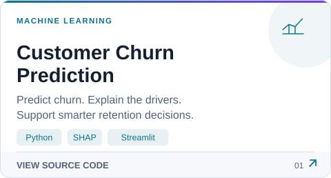
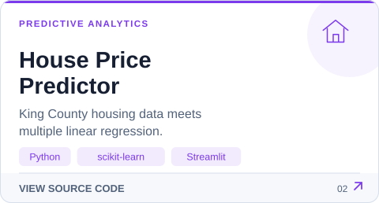
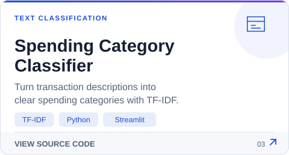

<picture>
    <source media="(prefers-color-scheme: dark)" srcset="https://raw.githubusercontent.com/gulshairdev/gulshairdev/main/dark.svg?v=animated-20261109">
    <source media="(prefers-color-scheme: light)" srcset="https://raw.githubusercontent.com/gulshairdev/gulshairdev/main/light.svg?v=animated-20261109">
    
  </picture>

  <a href="https://www.linkedin.com/in/gulshair/"><picture>
    <source media="(prefers-color-scheme: dark)" srcset="https://raw.githubusercontent.com/gulshairdev/gulshairdev/main/assets/social-linkedin-dark.svg?v=animated-20261109">
    <source media="(prefers-color-scheme: light)" srcset="https://raw.githubusercontent.com/gulshairdev/gulshairdev/main/assets/social-linkedin-light.svg?v=animated-20261109">
    
  </picture></a>
  <a href="mailto:gulshairkhaqan@gmail.com"><picture>
    <source media="(prefers-color-scheme: dark)" srcset="https://raw.githubusercontent.com/gulshairdev/gulshairdev/main/assets/social-email-dark.svg?v=animated-20261109">
    <source media="(prefers-color-scheme: light)" srcset="https://raw.githubusercontent.com/gulshairdev/gulshairdev/main/assets/social-email-light.svg?v=animated-20261109">
    
  </picture></a>
  <a href="https://www.instagram.com/gul_shair_khaqan/"><picture>
    <source media="(prefers-color-scheme: dark)" srcset="https://raw.githubusercontent.com/gulshairdev/gulshairdev/main/assets/social-instagram-dark.svg?v=animated-20261109">
    <source media="(prefers-color-scheme: light)" srcset="https://raw.githubusercontent.com/gulshairdev/gulshairdev/main/assets/social-instagram-light.svg?v=animated-20261109">
    
  </picture></a>
  <a href="https://www.facebook.com/share/19cBvZvLkP/"><picture>
    <source media="(prefers-color-scheme: dark)" srcset="https://raw.githubusercontent.com/gulshairdev/gulshairdev/main/assets/social-facebook-dark.svg?v=animated-20261109">
    <source media="(prefers-color-scheme: light)" srcset="https://raw.githubusercontent.com/gulshairdev/gulshairdev/main/assets/social-facebook-light.svg?v=animated-20261109">
    
  </picture></a>
  <a href="https://github.com/gulshairdev?tab=repositories"><picture>
    <source media="(prefers-color-scheme: dark)" srcset="https://raw.githubusercontent.com/gulshairdev/gulshairdev/main/assets/social-github-dark.svg?v=animated-20261109">
    <source media="(prefers-color-scheme: light)" srcset="https://raw.githubusercontent.com/gulshairdev/gulshairdev/main/assets/social-github-light.svg?v=animated-20261109">
    
  </picture></a>

## About Me

I'm **Gul Shair**, a BS Computer Science student at **Superior University, Lahore**, focused on **machine learning and AI automation**. I build prediction apps and workflows that turn ideas into useful tools.

- **Machine learning:** data preparation, model comparison, explainability, and Streamlit apps.
- **Automation:** connecting tools and simplifying repetitive work with n8n and Make.
- **Based in:** Lahore, Pakistan.

## Featured Projects

Explore the source code through each card, or try the two live demos below.

  <a href="https://github.com/gulshairdev/customer-churn-prediction-system"><picture>
    <source media="(prefers-color-scheme: dark)" srcset="https://raw.githubusercontent.com/gulshairdev/gulshairdev/main/project-churn.svg?v=animated-20261109">
    <source media="(prefers-color-scheme: light)" srcset="https://raw.githubusercontent.com/gulshairdev/gulshairdev/main/project-churn-light.svg?v=animated-20261109">
    
  </picture></a>
  <a href="https://github.com/gulshairdev/house-price-predictor-mlr"><picture>
    <source media="(prefers-color-scheme: dark)" srcset="https://raw.githubusercontent.com/gulshairdev/gulshairdev/main/project-house-price.svg?v=animated-20261109">
    <source media="(prefers-color-scheme: light)" srcset="https://raw.githubusercontent.com/gulshairdev/gulshairdev/main/project-house-price-light.svg?v=animated-20261109">
    
  </picture></a>
  <a href="https://github.com/gulshairdev/Customer-Spending-Classifier"><picture>
    <source media="(prefers-color-scheme: dark)" srcset="https://raw.githubusercontent.com/gulshairdev/gulshairdev/main/project-spending-classifier.svg?v=animated-20261109">
    <source media="(prefers-color-scheme: light)" srcset="https://raw.githubusercontent.com/gulshairdev/gulshairdev/main/project-spending-classifier-light.svg?v=animated-20261109">
    
  </picture></a>
  <a href="https://github.com/gulshairdev/automate-your-launch"><picture>
    <source media="(prefers-color-scheme: dark)" srcset="https://raw.githubusercontent.com/gulshairdev/gulshairdev/main/project-automate-launch.svg?v=animated-20261109">
    <source media="(prefers-color-scheme: light)" srcset="https://raw.githubusercontent.com/gulshairdev/gulshairdev/main/project-automate-launch-light.svg?v=animated-20261109">
    
  </picture></a>

  <a href="https://telco-retention-ai.streamlit.app"><picture>
    <source media="(prefers-color-scheme: dark)" srcset="https://raw.githubusercontent.com/gulshairdev/gulshairdev/main/assets/demo-churn-dark.svg?v=animated-20261109">
    <source media="(prefers-color-scheme: light)" srcset="https://raw.githubusercontent.com/gulshairdev/gulshairdev/main/assets/demo-churn-light.svg?v=animated-20261109">
    
  </picture></a>
  <a href="https://house-price-mlr-kingcounty.streamlit.app"><picture>
    <source media="(prefers-color-scheme: dark)" srcset="https://raw.githubusercontent.com/gulshairdev/gulshairdev/main/assets/demo-house-price-dark.svg?v=animated-20261109">
    <source media="(prefers-color-scheme: light)" srcset="https://raw.githubusercontent.com/gulshairdev/gulshairdev/main/assets/demo-house-price-light.svg?v=animated-20261109">
    
  </picture></a>

## Tech Stack

| Area | Tools |
| --- | --- |
| Languages | Python, C++, SQL, HTML/CSS, TypeScript |
| Machine Learning | scikit-learn, TensorFlow, XGBoost, LightGBM, SHAP |
| Data & Apps | pandas, NumPy, Streamlit |
| Automation | n8n, Make |
| Deployment | Streamlit Community Cloud, Hugging Face, Vercel |
| Development | Git, GitHub, VS Code |

## GitHub Activity

  <a href="https://github.com/gulshairdev?tab=overview">
    <picture>
      <source media="(prefers-color-scheme: dark)" srcset="https://streak-stats.demolab.com/?user=gulshairdev&amp;theme=dark&amp;hide_border=true&amp;card_width=495&amp;background=0A101F&amp;ring=A78BFA&amp;fire=10B981&amp;currStreakLabel=22D3EE&amp;sideLabels=CBD5E1&amp;dates=94A3B8&amp;disable_animations=true">
      
    </picture>
  </a>

### Watch the Snake Eat My Contributions

  <picture>
    <source media="(prefers-color-scheme: dark)" srcset="https://raw.githubusercontent.com/gulshairdev/gulshairdev/output/github-snake-dark.svg">
    <source media="(prefers-color-scheme: light)" srcset="https://raw.githubusercontent.com/gulshairdev/gulshairdev/output/github-snake.svg">
    
  </picture>

[View my GitHub contributions](https://github.com/gulshairdev?tab=overview) · [Browse all repositories](https://github.com/gulshairdev?tab=repositories)

## Let's Connect

For project discussions and collaboration: **[LinkedIn](https://www.linkedin.com/in/gulshair/)** or **[gulshairkhaqan@gmail.com](mailto:gulshairkhaqan@gmail.com)**.
